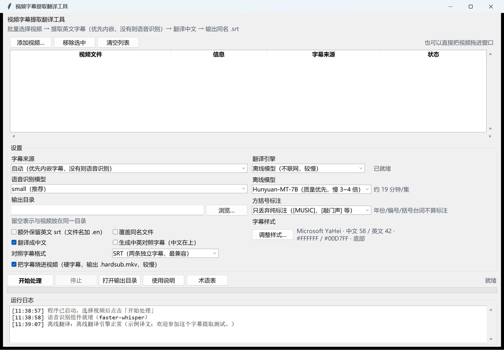
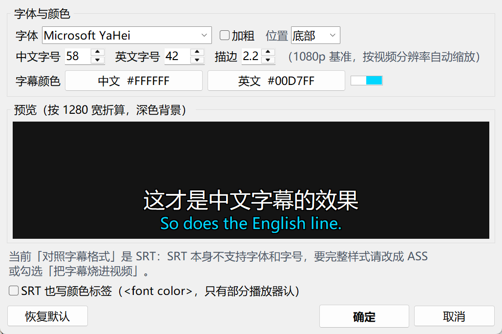

# Video Subtitle Extractor & Translator (Windows)

Batch-generate Chinese subtitles for your videos: **pull embedded English subtitle tracks or run Whisper ASR → translate to Chinese → write SRT, bilingual ASS, or burn the subtitles straight into the picture**. Everything can run fully offline — audio and video never leave your machine.

[中文说明](README.md)



## Features

- **Automatic subtitle source**: reads the embedded English subtitle track first (srt / ass / mov_text); when there is none it falls back to faster-whisper ASR (tiny / base / small / medium).
- **Two translation channels**: online (Google + MyMemory, no API key) or a local LLM (Tencent Hunyuan Hy-MT2-1.8B / Hunyuan-MT-7B via llama.cpp + GGUF, runs on CPU alone). The `auto` mode tries local first and falls back to online.
- **Bilingual output**: SRT (two tracks with identical timing — maximum compatibility) or ASS (configurable font, size, colour, outline, position; requires libass rendering).
- **Subtitle styling**: dedicated dialog with a live dark preview; separate size/colour for Chinese and English, bold, outline, top/bottom placement; sizes scale with video resolution.
- **Hard subtitles**: one click burns the two-line bilingual subtitle into the picture with ffmpeg + libass, producing `.hardsub.mkv` that no player can break.
- **Subtitle-aware translation**: pure annotations such as `[MUSIC]`, `[door slams]`, `(laughs)` are stripped instead of being translated (conservative rules keep numbers, indices, mid-sentence parentheses and `♪` lyrics); the glossary only injects terms that actually appear in the line; low-quality outputs are retried with a stricter prompt; Chinese punctuation and spacing are normalised.
- **Batch & caching**: drop a whole season folder, watch live progress, stop anytime; the translation cache is namespaced by *engine + model tier*, so re-runs only translate new or changed lines; llama-server ports are reused so multiple instances never fight for CPU.
- **Layout memory**: window geometry, list/log split ratio, column widths, subtitle style and the style dialog's own size are all persisted and restored on next launch.

## Requirements

- Windows 10 / 11 (64-bit)
- Python 3.10+ — or just use the portable build from [Releases](../../releases)
- `ffmpeg.exe` / `ffprobe.exe` (put them in `bin\` or on `PATH`)

## Quick start (from source)

```powershell
git clone <this-repo>.git
cd subtitles
pip install -r requirements.txt

mkdir bin            # drop ffmpeg.exe / ffprobe.exe here
python app\main.pyw
```

Whisper models are downloaded automatically on first ASR run. Offline translation needs `models\hy-mt2\Hy-MT2-1.8B-Q4_K_M.gguf` (~1.1 GB) plus `bin\llamacpp\llama-server.exe`; `tools\download_model.py` supports resumable downloads.

After a run you get, next to the video:

```
movie.mp4            ← source video
movie.srt            ← Chinese subtitles (translation-only mode)
movie.bilingual.srt  ← bilingual subtitles, Chinese on top, English below (optional)
movie.bilingual.ass  ← styled ASS bilingual subtitles (optional)
movie.hardsub.mkv    ← video with subtitles burned in (optional)
movie.en.srt         ← English original (optional)
```

> When bilingual or hard-subtitle output is enabled, Chinese is already inside that file, so no extra Chinese-only `.srt` is written — otherwise players would load the plain SRT first and hide the styled ASS.

## Using the app

### Main window

- Four list columns: file / info / subtitle source / status. Double-click a row to open its output folder.
- **Two draggable splitters** between the list and the log; dragging either one re-balances list vs log height while the settings block keeps its size and position.
- Settings are laid out in two columns: the left column runs from subtitle source to "burn subtitles into video", the right from translation engine to subtitle style. Each row keeps its label and control on the same line.

### Style dialog



- Font (picked from installed fonts), bold, position (bottom / top)
- Chinese size and English size (baseline 1080p, scaled per resolution)
- Chinese colour and English colour (system colour picker)
- Outline width; "write colour tags into SRT" wraps SRT lines in `<font color>` (only some players honour it)
- Live dark preview; **OK** applies and saves, **Cancel** restores everything, **Restore defaults** returns to factory values

## Command line

Passing a video path skips the GUI and processes with `data\config.json` settings:

```powershell
python app\main.pyw "D:\movies\E01.mkv"
python app\main.pyw E01.mkv E02.mkv --no-translate   # extract only, no translation
python app\main.pyw E01.mkv --burn                    # force hard subtitles
```

The packaged exe has no console; output goes to `data\logs\cli.log`. Exit code 0 means all files succeeded.

## Project layout

```
subtitles\
├─ app\
│  ├─ main.pyw            entry point (pythonw, no console)
│  └─ subtrans\
│     ├─ gui.py           Tkinter UI, style dialog, splitters, layout memory
│     ├─ pipeline.py      per-video processing pipeline
│     ├─ ffmpeg_tools.py  ffmpeg/ffprobe helpers (extract, burn)
│     ├─ asr.py           faster-whisper ASR
│     ├─ translate.py     online/offline translation + cache
│     ├─ localmt.py       local translation via llama.cpp + Hy-MT
│     ├─ ass.py           ASS writer and subtitle style model
│     ├─ srt.py           SRT parsing / writing / wrapping
│     ├─ burnin.py        hard-subtitle burning
│     ├─ config.py        config read/write (DEFAULTS whitelist)
│     └─ paths.py         path resolution (source vs frozen)
├─ tools\
│  ├─ build_exe.py        one-shot exe packaging
│  ├─ pack.spec           PyInstaller spec
│  └─ download_model.py   resumable model downloader
├─ docs\                  screenshots used in the README
├─ install.ps1            portable environment installer (works with runtime\python)
├─ bin\                   ffmpeg / ffprobe / llamacpp (not in repo)
├─ models\                Whisper, Hy-MT2, Hunyuan-MT-7B (not in repo)
├─ data\                  config, glossary, translation cache, logs (generated)
└─ testdata\              test assets (not in repo)
```

## ASR model choice

| Model | Size | Speed | When to use |
|-------|------|-------|-------------|
| tiny | ~75MB | fastest | speed over accuracy |
| base | ~145MB | fast | clean dialogue, light accents |
| small | ~500MB | balanced | **default — best accuracy/speed trade-off** |
| medium | ~1.5GB | slow | heavy accents, noisy background |

## Offline translation speed

Reference machine: Ryzen 7 4700U (8 cores, CPU only)

| Tier | Model size | Per line | 40-minute episode |
|------|-----------|----------|-------------------|
| `Hy-MT2-1.8B` | 1.1GB | 0.6–0.8 s | 4–6 min |
| `Hunyuan-MT-7B` | 4.3GB | ~2.5 s | 15–19 min |

On a machine with a discrete GPU the 7B tier drops to roughly 0.2–0.4 s per line.

## Packaging into an exe

```powershell
python tools\build_exe.py
```

Output lands in `dist\VideoSubtitleTool\`: `VideoSubtitleTool.exe` + `_internal\` (Python runtime) + `bin\` + `models\` + `data\`. The whole folder is portable to any 64-bit Win10/11 machine. PyInstaller `--onedir` is used instead of one-file: the models are ~6 GB, and a one-file build would unpack to a temp folder on every launch.

## FAQ

- **"ffmpeg not found"**: put `ffmpeg.exe` / `ffprobe.exe` into `bin\` or on `PATH`.
- **Online translation is slow or partially failing**: free endpoints rate-limit (HTTP 429); the app backs off and retries, or switch to the offline model.
- **"Model missing" for offline translation**: download the matching GGUF into `models\hy-mt2\` or `models\hy-mt2-7b\`.
- **No embedded subtitles**: expected — `auto` mode falls back to ASR.
- **Inaccurate recognition**: switch to `medium`, or raise the dialogue volume.
- **Bitmap subtitles (PGS/VOBSUB)**: images, not text; the app reports it and falls back to ASR.
- **Antivirus false positives**: portable Python and ffmpeg are common false-positive targets — whitelist the folder.
- **ASS collapses into one line**: PotPlayer's "output directly on video" mode eats `\N`; use libass rendering or the hard-subtitle file.

## License

No license is declared yet, which means all rights reserved by default. Add a `LICENSE` file (MIT / Apache-2.0 / etc.) if you want to open-source it formally.
