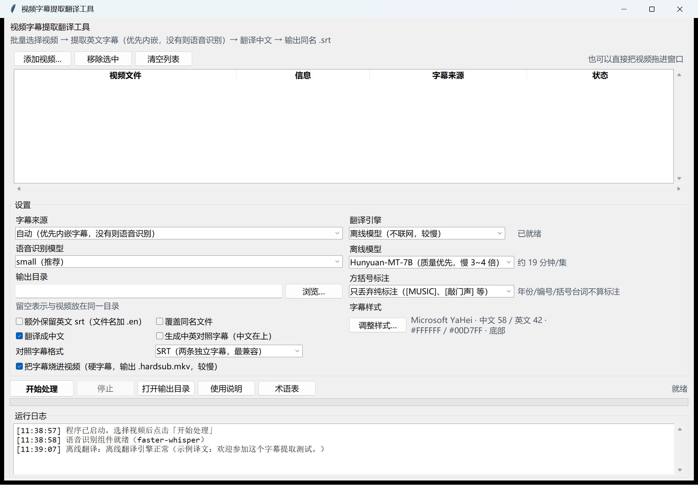
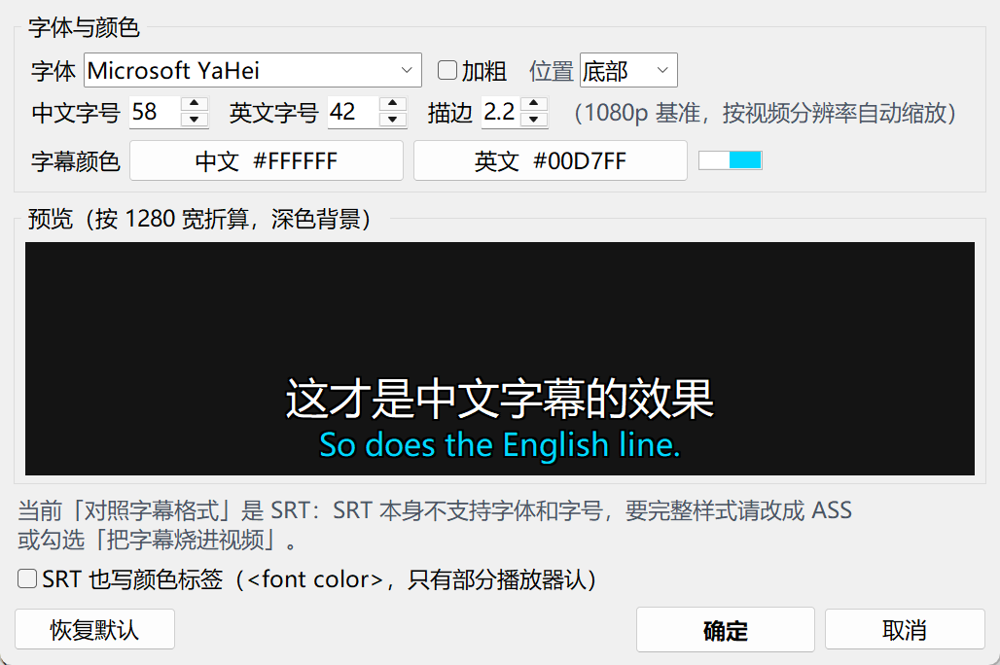

# 视频字幕提取翻译工具（Windows）

批量给视频生成中文字幕：**提取内嵌英文字幕 / Whisper 语音识别 → 翻译成中文 → 输出 SRT、中英对照 ASS 或直接把字幕烧进画面**。全部离线可跑，音视频不出本机。

[English README](README.en.md)



## 特性

- **字幕来源自动化**：优先读视频内嵌英文字幕轨（srt / ass / mov_text）；没有就自动切到 faster-whisper 语音识别（tiny / base / small / medium 四档可切）。
- **两种翻译通道**：在线（Google + MyMemory，免 API Key）或本地大模型（腾讯混元 Hy-MT2-1.8B / Hunyuan-MT-7B，llama.cpp + GGUF，纯 CPU 可跑）；「自动」模式离线优先、失败回落在线。
- **中英对照**：SRT（两条时间轴相同的字幕，兼容性最好）或 ASS（字体/字号/颜色/描边/位置可调，需播放器 libass 渲染）。
- **字幕样式**：独立设置窗口，实时深色预览；中英文可分别设字号和颜色，支持加粗、描边、置顶/置底，字号按视频分辨率自动等比缩放。
- **硬字幕**：一键用 ffmpeg + libass 把中英双行烧进画面，输出 `.hardsub.mkv`，任何播放器都不会压行。
- **字幕场景优化**：`[MUSIC]`、`[door slams]`、`(laughs)` 这类纯标注自动剔除不送翻译（含数字、编号、带标点括注、`♪` 歌词等保守放行）；术语表只注入本句命中的词；译文质量不佳自动重译一次；中文标点与空格规范化。
- **批量与缓存**：整个剧集目录一次加入，实时进度、随时停止；译文缓存按「引擎＋模型档位」分开存，重跑只译新增或改动的句子；llama-server 端口复用，避免多实例抢 CPU。
- **窗口状态记忆**：窗口尺寸位置、列表与日志分栏比例、列表四栏宽度、字幕样式、样式窗口位置，退出时全部记住，下次原样打开。

## 运行要求

- Windows 10 / 11（64 位）
- Python 3.10+，或直接使用 [Releases](../../releases) 里的免安装 exe 打包版
- `ffmpeg.exe` / `ffprobe.exe`（放进 `bin\`，或加入 PATH）

## 快速开始（从源码）

```powershell
git clone <this-repo>.git
cd subtitles
pip install -r requirements.txt

# 准备 ffmpeg（示例：把解压出来的两个 exe 放到 bin\）
mkdir bin

python app\main.pyw
```

首次语音识别会自动下载 Whisper 模型；离线翻译需要 `models\hy-mt2\Hy-MT2-1.8B-Q4_K_M.gguf`（约 1.1GB）与 `bin\llamacpp\llama-server.exe`，脚本 `tools\download_model.py` 支持断点续传下载。

处理完成后，视频同目录会出现：

```
movie.mp4            ← 原视频
movie.srt            ← 中文字幕（只开翻译时）
movie.bilingual.srt  ← 中英对照字幕，中文在上、英文在下（可选）
movie.bilingual.ass  ← 带样式的 ASS 对照字幕（可选）
movie.hardsub.mkv    ← 字幕已烧进画面的视频（可选）
movie.en.srt         ← 英文原文（可选）
```

> 若同时开了「中英对照」或「烧进视频」，中文已含在对应产物里，就不再额外输出纯中文 `.srt`，避免播放器优先加载 .srt 盖掉对照字幕样式。

## 界面说明

### 主窗口

- 视频列表四栏：视频文件 / 信息 / 字幕来源 / 状态，双击任意行可打开输出目录。
- 列表与日志之间有**两条可拖动分隔条**：拖上面那条改列表/日志比例，拖列表下方那条同样有效；「设置」区位置和高度始终不变。
- 设置区两列排布，左列从字幕来源到「把字幕烧进视频」，右列从翻译引擎到字幕样式，每行标签与输入框同行。

### 字幕样式窗口



- 字体（下拉选本机已装字体）、加粗、位置（底部 / 顶部）
- 中文字号 / 英文字号（1080p 基准，按视频分辨率等比缩放）
- 中文颜色 / 英文颜色（系统调色板）
- 描边粗细；勾选「SRT 也写颜色标签」会给 SRT 行套 `<font color>`（仅部分播放器认）
- 深色预览区实时重绘；「确定」写回并保存，「取消」全部还原，「恢复默认」回到出厂值

## 命令行用法

带视频路径启动时不开界面，按 `data\config.json` 的设置直接处理：

```powershell
python app\main.pyw "D:\movies\E01.mkv"
python app\main.pyw E01.mkv E02.mkv --no-translate   # 只提取字幕、不翻译
python app\main.pyw E01.mkv --burn                    # 强制烧硬字幕
```

打包版 exe 没有控制台，输出写入 `data\logs\cli.log`；退出码 0 表示全部成功。

## 目录结构

```
subtitles\
├─ app\
│  ├─ main.pyw            入口（pythonw 无控制台）
│  └─ subtrans\
│     ├─ gui.py           Tkinter 界面、样式窗口、分栏与状态记忆
│     ├─ pipeline.py      单个视频的处理流程
│     ├─ ffmpeg_tools.py  ffmpeg/ffprobe 封装（抽字幕、抽音轨、烧字幕）
│     ├─ asr.py           faster-whisper 语音识别
│     ├─ translate.py     翻译通道（在线 / 离线）与译文缓存
│     ├─ localmt.py       离线翻译：llama.cpp + Hy-MT 常驻服务
│     ├─ ass.py           ASS 生成与字幕样式
│     ├─ srt.py           SRT 解析 / 写出 / 折行
│     ├─ burnin.py        硬字幕烧录
│     ├─ config.py        配置读写（含 DEFAULTS 白名单）
│     └─ paths.py         路径解析（源码 / frozen 两种形态）
├─ tools\
│  ├─ build_exe.py        一键打包 exe
│  ├─ pack.spec           PyInstaller 配置
│  └─ download_model.py   模型下载（断点续传）
├─ docs\                  说明用截图
├─ install.ps1            便携环境一键安装/修复（配合 runtime\python）
├─ bin\                   ffmpeg / ffprobe / llamacpp（自行准备，不入库）
├─ models\                Whisper、Hy-MT2、Hunyuan-MT-7B（自行下载，不入库）
├─ data\                  配置、术语表、翻译缓存、日志（运行后生成）
└─ testdata\              自测素材（不入库）
```

## 语音识别模型选择

| 模型 | 体积 | 速度 | 建议 |
|------|------|------|------|
| tiny | ~75MB | 最快 | 只求速度 |
| base | ~145MB | 快 | 口音轻、清晰对白 |
| small | ~500MB | 适中 | **默认，准确率与速度平衡** |
| medium | ~1.5GB | 慢 | 口音重、背景嘈杂 |

## 离线翻译速度参考

测试机：Ryzen 7 4700U（8 核，纯 CPU）

| 档位 | 模型体积 | 单句耗时 | 40 分钟剧集 |
|------|----------|----------|-------------|
| `Hy-MT2-1.8B` | 1.1GB | 0.6~0.8 秒 | 4~6 分钟 |
| `Hunyuan-MT-7B` | 4.3GB | 约 2.5 秒 | 15~19 分钟 |

换到带独显的机器，7B 可降到 0.2~0.4 秒/句。

## 打包成 exe

```powershell
python tools\build_exe.py
```

产物在 `dist\视频字幕工具\`：`视频字幕工具.exe` + `_internal\`（Python 运行时）+ `bin\` + `models\` + `data\`，整个文件夹可直接拷到别的 64 位 Win10/11 使用。采用 PyInstaller `--onedir` 而非单文件——模型有 6GB，单文件每次启动都要解包到临时目录。

## 常见问题

- **提示找不到 ffmpeg**：把 `ffmpeg.exe`、`ffprobe.exe` 放进 `bin\`，或加入 PATH。
- **在线翻译慢或部分失败**：免费接口有频率限制（常见 HTTP 429），程序会退避重试；也可切到离线模型。
- **离线翻译报“模型缺失”**：下载对应 GGUF 到 `models\hy-mt2\` 或 `models\hy-mt2-7b\`。
- **视频没有内嵌字幕**：正常，「自动」模式会转语音识别。
- **识别不准**：换 `medium` 模型，或提高对白音量。
- **图形字幕（PGS/VOBSUB）**：属于图片字幕，无法提取文字，程序会提示并转语音识别。
- **杀毒软件误报**：便携 Python 与 ffmpeg 属常见误报对象，可把目录加入信任。
- **ASS 在播放器里挤成一行**：PotPlayer 若把字幕渲染设为「在视频上直接输出」会吃掉 `\N`，改用 libass 渲染或直接用硬字幕版本。

## 许可

未声明许可证前，默认保留所有权利；如需开源协议（MIT / Apache-2.0 等）可自行添加 `LICENSE` 文件。
